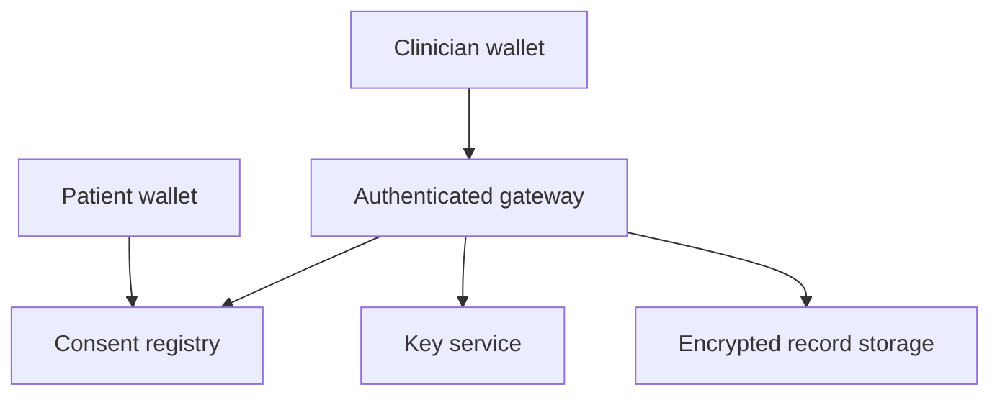

# Medical Records Registry

Solidity prototype • 21 October 2026 • not deployed

A patient-controlled consent and integrity registry for **encrypted, off-chain** medical records. The contract stores commitments, authorship, versions and permissions. It does not store clinical data, encrypt files, authenticate clinicians, or deliver records.

## Run locally

Requires Node.js 22+ and npm. Dependencies are pinned; the lockfile is included.

```sh
npm ci
npm run compile
npm test
npm run demo
```

The demo uses a disposable local Ganache chain and synthetic data; no wallet, funds or real records are needed. Compilation uses Solidity 0.8.30, optimizer 200 runs, Paris EVM. The compiler version is deliberately pinned for reproducibility, not claimed to be the latest. The generated artifact includes ABI, bytecode and metadata. Review compiler advisories and target-chain compatibility before deployment.

## Architecture



| On-chain | Off-chain |
| --- | --- |
| Patient and delegate wallet addresses | Names, diagnoses, FHIR resources, images |
| Random record identifier | Encrypted file and retrieval location |
| Hash of encrypted envelope | Encryption keys and key envelopes |
| Opaque locator commitment | Locator token, identity verification |
| Version, author, timestamp | Actual access logs, retention and backups |
| Expiring read/write permissions | Authentication and enforced key release |

Wallet relationships, transactions, timing, commitments and historical grants remain public. A Solidity `private` mapping is not confidential. Never submit PHI, URLs, passwords, encryption keys, or hashes of low-entropy plaintext records in calldata, events, or storage. A bytes32 parameter cannot prevent a caller from misusing it.

## API

| Method | Behavior |
| --- | --- |
| `createRecord(salt, locatorCommitment, ciphertextHash)` | Caller becomes patient/controller; creates version 1 |
| `computeRecordId(patient, salt)` | Derives ID in the patient's namespace |
| `appendVersion(id, expectedVersion, locatorCommitment, ciphertextHash)` | Patient or authorized writer appends; stale expected version reverts |
| `grantAccess(id, delegate, permissions, expiresAt)` | Patient replaces delegate grant; READ=1, WRITE=2, both=3 |
| `revokeAccess(id, delegate)` | Patient removes one grant |
| `revokeAllAccess()` | Caller invalidates all their existing delegate grants using an epoch |
| `setArchived(id, archived)` | Patient suspends/reactivates access and appends |
| `canRead(id, account)` / `canWrite(id, account)` | Gateway policy checks; not authentication or encryption |
| `getRecord`, `getVersion`, `getGrant` | Public metadata getters; grant getter may show expired/stale grants |

Versions begin at 1. READ and WRITE are independent. WRITE alone permits publishing a new version but does not authorize downloading prior contents. Permissions apply to the record, including its past and future versions; version-scoped consent is not implemented. Grants expire when `block.timestamp >= expiresAt`. Unknown record access checks return false. Patient access also returns false while archived. Restoring reactivates still-valid grants. Revoke individual grants or use `revokeAllAccess()` to prevent reactivation.

## Integration protocol

1. Authenticate the patient and provider outside the contract. Wallet control alone does not establish patient identity or a medical license. Use a recoverable smart account if appropriate; this registry has no built-in ownership transfer or recovery.
2. Generate a fresh cryptographically random record salt, opaque locator token, and per-version encryption key. Encrypt the entire record with authenticated encryption, such as AES-256-GCM, with a fresh nonce. Bind chain ID, registry address, record ID and version as authenticated additional data. Persist the envelope format and algorithm version.
3. Store encrypted bytes behind authenticated storage. Commit `keccak256(encryptedEnvelope)` and `keccak256(randomLocatorToken)` on-chain. Never hash a name, medical identifier or predictable URL as a locator. The backend maps the token commitment to storage; the commitment alone is not a download capability.
4. Before releasing any record or decryption key, authenticate the requesting wallet with a short-lived, one-use challenge bound to domain, chain ID, registry, record and action. Verify contract-wallet signatures where supported. Query `canRead` for the authenticated address against the correct registry on a trusted node. Fail closed if chain state is unavailable or stale. Recheck before release and on every new request; do not rely solely on cached events.
5. Verify the encrypted envelope hash against the selected on-chain version before decryption. A matching hash proves integrity relative to the submitted commitment, not medical truth or authorship by a licensed clinician.
6. Writers upload an encrypted candidate version before submitting `appendVersion` with the current version count. Only treat it as committed after the transaction succeeds; manage failed-upload orphans off-chain.
7. Record actual file and key releases in protected off-chain audit logs. Contract events capture registry mutations, not reads. Handle confirmations, reorganizations and transaction ordering explicitly; a pending revocation is not yet effective, and an already authorized response may be in flight.

## Security boundaries

- Revocation stops future access through a cooperating gateway. It cannot erase plaintext or keys already copied. Rotate keys and re-encrypt future versions; historical ciphertext and disclosed keys remain usable together.
- No administrator, proxy, external calls, payments, emergency bypass, or hidden privileged role. No global emergency pause or recovery mechanism is provided.
- A patient or authorized writer can submit false or unavailable content. Off-chain validation and clinical provenance are required.
- The chain does not guarantee file availability. Backups, retention, deletion and key custody belong to the storage system.
- This prototype is not an independent security audit or a complete healthcare compliance solution. Production use needs a reviewed gateway/key service, operational controls, privacy assessment and external contract review.

See `SECURITY_REVIEW.md` for the agent review and `VALIDATION.md` for executed checks. The package contains no real patient data or deployment keys.

## Primary references

- [Solidity security considerations](https://docs.soliditylang.org/en/latest/security-considerations.html): public state, authorization and external-call risks.
- [Ethereum storage strategies](https://ethereum.org/developers/docs/data-availability/blockchain-data-storage-strategies/): on-chain versus off-chain storage tradeoffs.


## Copyright

Copyright (c) 2026 Clinical Outcomes Research Group, CORG LLC. Released under the MIT License; see LICENSE and NOTICE.
